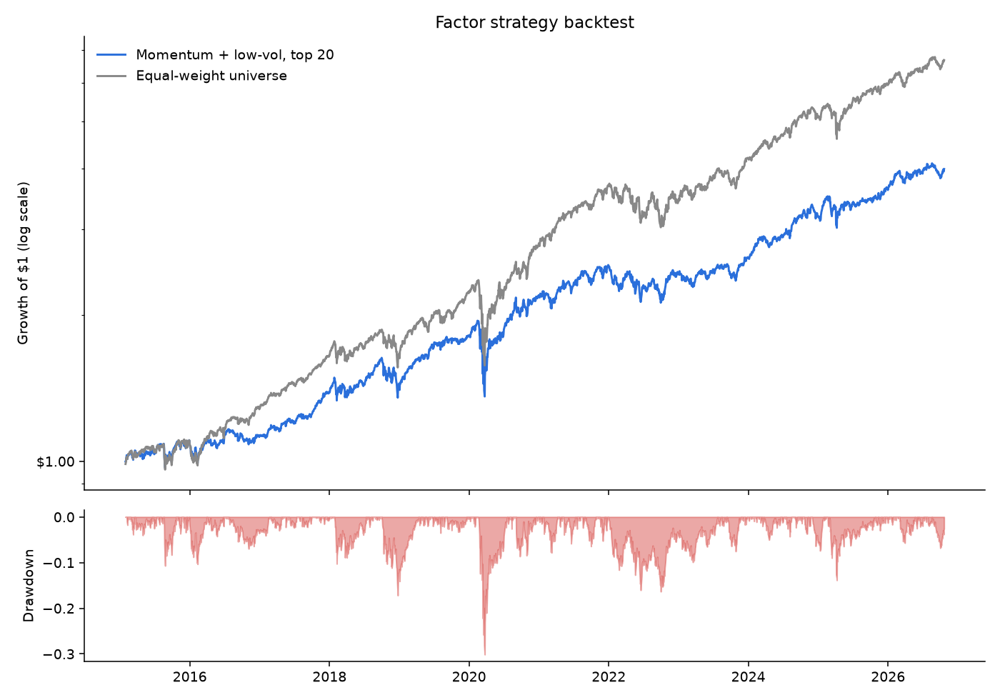

# Evidence-Based Portfolio Toolkit

Three tools that do the analysis an advisor would do and leave the decisions to you.
It produces **information, not advice**, and nothing here predicts prices.

| Command | What it does |
|---|---|
| `screen` | Ranks a stock universe on four factors with long-run academic evidence (momentum, low volatility, value, quality), capped per sector |
| `backtest` | Tests a momentum + low-vol strategy historically (monthly rebalance, trading costs) against an equal-weight benchmark |
| `risk` | Breaks down your actual holdings: concentration, sector mix, which positions drive your risk, and a Monte Carlo of 1-year outcomes |

## Setup

```bash
pip install -r requirements.txt
python advisor.py --synthetic risk BTC-USD=1000 AAPL=200   # offline smoke test
```

## Usage

```bash
python advisor.py screen --top 20 --max-per-sector 3
python advisor.py --start 2012-01-01 backtest --top 20
python advisor.py risk BTC-USD=1000 JPM=150 LLY=150 COST=150 XOM=150 --years 1
```

Holdings are `TICKER=dollars`. Crypto uses Yahoo symbols (`BTC-USD`, `ETH-USD`).
Edit `universe.txt` to change which stocks the screener and backtest consider.
Results and charts go to `output/`.

## Results

Backtest of the momentum + low-volatility strategy from January 2015 to October 2026: top 20 stocks from a ~70-stock large-cap universe, rebalanced monthly, 10 bps cost per trade.

| | Strategy | Equal-weight universe |
|---|---|---|
| CAGR | 12.5% | 17.7% |
| Volatility | 16.0% | 16.6% |
| Sharpe (rf = 0) | 0.78 | 1.07 |
| Max drawdown | −30.1% | −33.2% |
| Worst month | −8.2% | −10.8% |
| % months up | 62.4% | 71.6% |



**The strategy underperformed by 5.2% a year.** It had slightly lower volatility, a shallower worst drawdown and a milder worst month, but it gave up far more return than it saved in risk. The two lines track closely until 2020; most of the gap opens in the 2020–2021 rebound and widens through 2023–2026.

Both lines are overstated by survivorship bias (see limitations below), so the comparison between them matters more than either number on its own.

Reproduce with:

```bash
python advisor.py backtest   # defaults: data from 2014, top 20, 10 bps
```

## How each piece works

**Screener.** Every factor is z-scored across the universe (winsorized at 5/95%), so 0 means
average and +1 means one standard deviation better. The composite is an equal-weighted average.
- Momentum: 12-month return skipping the most recent month (Jegadeesh & Titman, 1993)
- Low volatility: lower 1-year volatility (Frazzini & Pedersen, 2014)
- Value: earnings yield and book-to-price (Fama & French, 1992)
- Quality: ROE, profit margin, lower debt/equity (Novy-Marx, 2013; Asness, Frazzini & Pedersen, 2019)

**Backtest.** Uses only price-based factors. Free data only provides *today's* fundamentals,
and using today's P/E to choose stocks in 2015 is look-ahead bias.

**Risk / Monte Carlo.** Uses a block bootstrap: it resamples real 21-day chunks of your
portfolio's historical returns. This keeps fat tails, crash clustering and correlations
(such as everything falling together in 2020 and 2022) that a normal-distribution model misses.
By default (`--mode realistic`) each asset's average return is reset to a forward-looking
assumption: 7%/yr for stocks and 0% for crypto. The swings, crashes and correlations still come from
real history, so only the drift changes. Adjust the assumptions with `--stock-return 0.06` or
`--assume BTC-USD=0.10 AAPL=0.08`, or use `--mode historical` to replay the past unchanged.
"Risk share" is each holding's contribution to total portfolio variance. A 15% position can drive
60% of your risk if it is volatile enough.

## Honest limitations (read these)

1. **Survivorship bias.** The default universe is today's large companies, i.e. the winners.
   Any backtest on it overstates returns, for both the strategy and the benchmark.
2. **Factor premiums are small and unreliable.** Each has gone years underperforming.
   Strong backtest numbers mostly reflect noise and the period chosen.
3. **The past isn't a distribution of the future.** The Monte Carlo only reuses history you
   give it. A short Bitcoin history or an unusually good decade will skew it.
4. **Yahoo data is unofficial.** Fields can be missing or wrong. Spot-check anything surprising.
5. **Taxes aren't modeled.** Selling within a year is taxed as ordinary income.

## Ideas to extend it

- Plug the risk module into a regime-switching simulator instead of the bootstrap
- Add point-in-time fundamentals (e.g. SEC EDGAR XBRL data) so value/quality can be backtested
- Walk-forward testing: choose factor weights on 2010–2018, evaluate only on 2019+
